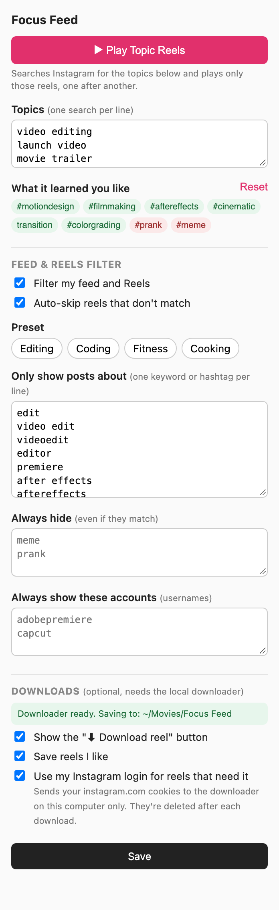

<p align="center">
  
</p>

<h1 align="center">Focus Feed</h1>

<p align="center">
  <b>Keep Instagram on-topic.</b><br>
  A free, open-source Chrome extension that shows you only the reels you care about.
</p>

<p align="center">
  <a href="https://github.com/kunalsharmavlog-hue/focus-feed/releases/latest"></a>
  
  <a href="LICENSE"></a>
</p>

Tell Focus Feed what you care about (video editing, coding, fitness, anything) and it filters
out the rest, plays only reels about your topics, learns what you actually like, and can save
reels you love to a folder on your computer.

Works on **instagram.com in Chrome** (desktop). It can't change the Instagram phone app.

<p align="center">
  
</p>

## Features

- **Topic Reels.** Click **▶ Topic Reels** (bottom-right on Instagram, or in the popup).
  Focus Feed searches Instagram for your topics and plays those reels one after another.
  When a reel ends the next one opens; when a topic runs out it moves to the next topic.
  Reels you've already seen are skipped. Close the reel (✕ or Esc) or click
  **■ Stop Topic Reels** to stop. The first reel starts muted (a browser rule); unmute once.
- **Feed & Reels filter.** On your home feed and the Reels tab, posts that don't match
  your keywords are collapsed or skipped automatically. Keywords match at the start of a
  word, so `edit` matches *editing* and *editor* but not *credit*. Add words to always hide,
  and accounts to always show.
- **Learns what you like.** Likes, saves, watching a reel to the end or rewatching it count
  as "more like this"; skipping within a couple of seconds counts as "less". It scores
  creators, hashtags and caption words. Your favourite hashtags are added to Topic Reels.
  See what it learned in the popup (green = likes, red = skips), or reset it.
- **Save reels (optional).** A **⬇ Download reel** button saves the reel on screen, and
  liking a reel can save it too. Videos are converted to H.264 so they open in QuickTime,
  Premiere Pro, DaVinci Resolve and other editors. Needs the downloader below.

## Install

1. Download the latest `focus-feed-vX.Y.Z.zip` from [Releases](https://github.com/kunalsharmavlog-hue/focus-feed/releases/latest)
   and unzip it, or clone this repo.
2. Open `chrome://extensions`, turn on **Developer mode** (top right).
3. Click **Load unpacked** and pick this folder (the one with `manifest.json`).
4. Pin **Focus Feed** from the puzzle-piece menu, open it, pick a preset or type your
   keywords and topics, and click **Save**.
5. Open or refresh instagram.com.

**Updating:** after changing or pulling new files, quit Chrome completely (Cmd+Q / Ctrl+Q)
and reopen it. The ↻ reload button on `chrome://extensions` also works, but a full restart
is the most reliable.

## Optional: the downloader

Chrome extensions can't write files outside your Downloads folder or run programs, so saving
reels uses a small local helper (`saver/host.py`) that Chrome talks to through
[native messaging](https://developer.chrome.com/docs/extensions/develop/concepts/native-messaging).
It runs [yt-dlp](https://github.com/yt-dlp/yt-dlp) and [ffmpeg](https://ffmpeg.org).

macOS or Linux, Google Chrome:

```sh
brew install yt-dlp ffmpeg          # or your package manager
sh saver/install.sh                 # saves to ~/Movies/Focus Feed (macOS) / ~/Videos/Focus Feed
sh saver/install.sh "/Volumes/MyDrive/Reels"   # or choose any folder, e.g. on an external drive
```

Then restart Chrome. The popup shows "Downloader ready" and where files go. Saved files are
named `Creator - ID.mp4`; the same reel is never downloaded twice. If the folder is on an
external drive that isn't connected, you'll get a message instead of a download.

Some reels can only be fetched while logged in. For those, turn on **Use my Instagram login**
in the popup (off by default, see Privacy).

Log file: `~/Library/Logs/focus-feed-saver.log` (macOS) or `~/.cache/focus-feed-saver.log`.
To remove: `sh saver/uninstall.sh` (your videos are kept). Windows isn't supported yet.

## Privacy

- Everything runs on your computer. Focus Feed has no server and sends nothing anywhere
  except Instagram itself (and, for downloads, the local helper on your machine).
- Your settings sync through your Chrome account (`chrome.storage.sync`). What it learns
  about your taste and which reels you've seen stay on this computer (`chrome.storage.local`).
- **Use my Instagram login** is off by default. When on, each download passes your
  instagram.com cookies to the local helper, which writes them to a private temporary file
  readable only by your user, uses them for that one download, and deletes it. Anyone with
  those cookies could use your Instagram session, so only turn this on for a computer you trust.

## Good to know

- Not affiliated with, endorsed by, or connected to Instagram or Meta.
- Downloaded reels belong to their creators. Keep them for personal reference; don't re-upload
  them without permission, and respect Instagram's Terms of Use.
- The filter works on text (captions, hashtags, usernames, image descriptions). A reel with no
  matching words gets filtered even if it's on-topic; add its creator to "Always show".
- Instagram changes its website often. If something stops working, please open an issue.

## Files

| File | What it does |
| --- | --- |
| `manifest.json` | Extension manifest (Manifest V3) |
| `defaults.js` | Presets, default topics and settings |
| `content.js` | Feed and Reels filter |
| `focus.js` | Topic Reels player |
| `taste.js` | Learns your taste; Download button; like detection |
| `background.js` | Talks to the downloader |
| `popup.html`, `popup.js` | Settings popup |
| `content.css` | On-page buttons, covers and messages |
| `saver/` | Optional downloader (`install.sh`, `host.py`, `uninstall.sh`) |
| `icons/`, `docs/` | Extension icons and README images |

## Contributing

Bug reports and pull requests are welcome. Instagram changes its markup often, so if a feature
breaks, an issue with a screenshot and the page URL (`/reels/`, `/p/…`, search) helps most.

## License

MIT, see [LICENSE](LICENSE).

---

Made by Kunal ([@kunalsharmavlog-hue](https://github.com/kunalsharmavlog-hue)). Also by Kunal:
[Revive](https://github.com/kunalsharmavlog-hue/revive) (free data recovery for Mac) and
[Pangolin](https://github.com/kunalsharmavlog-hue/pangolin) (free Mac cleaner and system monitor).
